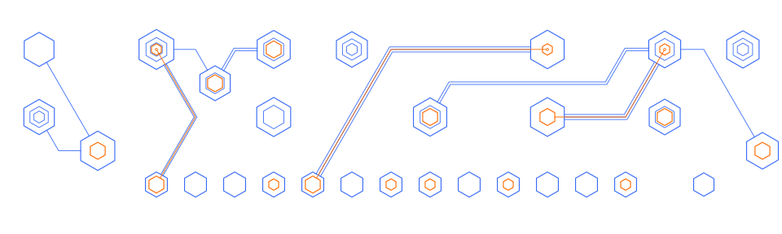

# circuitboard



`circuitboard` generates randomized hexagonal PCB-inspired artwork using the shared
`hexgrid` geometry and SVG renderer. Its composition algorithm is separate from the
`circuit` package: it places several spatially distributed component clusters, builds
an irregular branched network with a lightweight randomized A* router, then fills
remaining spaces with smaller, often unconnected components.

The design always includes a horizontal row of connector components at the bottom.
The base color draws ordinary components and signal traces; the accent color marks
power feeds and selected component cores. The optional background hex field is off
by default.

## Usage

```go
package main

import (
    "os"

    "github.com/sector-f/hexcircuit/circuitboard"
)

func main() {
    options := circuitboard.DefaultOptions()
    options.ShowBackgroundGrid = true
    options.Seed = 1234
    options.SeedSet = true

    svg, _, _, err := circuitboard.Generate(options)
    if err != nil {
        panic(err)
    }
    if err := os.WriteFile("board.svg", []byte(svg), 0644); err != nil {
        panic(err)
    }
}
```

Leaving `SeedSet` false selects a new seed for each call. Set it true to make the
same options produce identical SVG output.

## Options

All dimensions are in inches. `Width` and `Height` define a rectangular canvas.
`ComponentCount` is the requested number of generated components and does not
include the mandatory connector row. The returned component count does include it.
`ClusterCount` controls the number of large component clusters. `Connections`
is the target number of routed trace bundles. `MaxParallel` can be 1, 2, or 3.

`ShowBackgroundGrid` enables the hexagonal background field; it defaults to false.
`OmitPartialGridHexagons` controls whether background hexagons clipped by the
rectangular canvas are omitted; it defaults to false. Components and routing are
kept away from edge cells regardless of this setting. `BaseColor` and `AccentColor`
control ordinary signal artwork and power highlights.

The router uses the same edge-safe interior for all trace paths, so bundles do not
run along the canvas boundary. Traces attached to the mandatory bottom connector
row originate at the connector and begin by heading northeast or northwest.

The default canvas is 10 x 8 inches, with 38 generated components, six clusters,
18 trace bundles, and 13 bottom-edge contacts.
